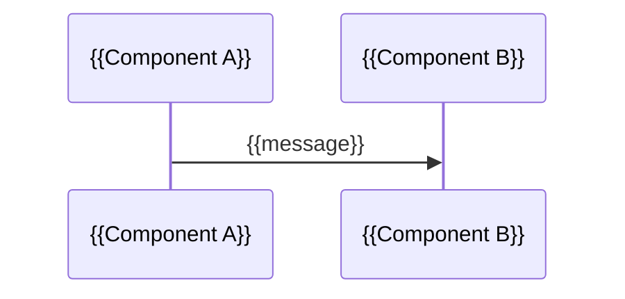

# Detailed Design Specification: {{SOFTWARE_NAME}}
Generated: {{DATE}}

## 1. Introduction

{{What this document is and who uses it: the detailed design based on the SRS.}}

## 2. System architecture

{{The system as a whole: its components, modules, and the main flow between them.}}

| Component | Module | Responsibility |
| --- | --- | --- |
| {{name}} | {{name}} | {{what it is responsible for}} |

*Diagram: system architecture, showing how the components fit together.*

```mermaid
%%{init: {"flowchart": {"curve": "step", "nodeSpacing": 60, "rankSpacing": 70}}}%%
flowchart LR
  subgraph A[{{Component A}}]
    A1[{{Module A1}}] --> A2[{{Module A2}}]
  end
  A --> B[{{Component B}}]
```

## 3. Components

<!-- Repeat per component. -->

### 3.x {{COMPONENT}}: {{name}}

{{Purpose of the component and where it sits in the flow.}}

*Diagram: {{COMPONENT}} architecture.*

```mermaid
%%{init: {"flowchart": {"curve": "step", "nodeSpacing": 60, "rankSpacing": 70}}}%%
flowchart LR
  subgraph {{COMPONENT}}
    M1[{{Module 1}}] --> M2[{{Module 2}}]
  end
  X[{{Neighboring component or external system}}] --> M1
  M2 --> Y[{{Neighboring component or external system}}]
```

**Modules**

| Module | Responsibility |
| --- | --- |
| {{name}} | {{what it owns and is responsible for}} |

**Behavior**

1. {{steps the component performs, in order if sequential}}

| | |
| --- | --- |
| Inputs | {{what it receives, from where, and its format and limits}} |
| Outputs | {{what it produces, where it goes, and its format and limits}} |
| Depends on | {{components and external systems}} |
| Requirements | {{IDs}} |

## 4. Data

{{How data moves through the system, what is stored and where, what is deliberately not stored, and how sensitive data is handled.}}

*Diagram: data flow.*



## 5. External interfaces

| System | Direction | Content | Authentication |
| --- | --- | --- | --- |
| {{...}} | {{in/out}} | {{data types and what gets communicated}} | {{...}} |
